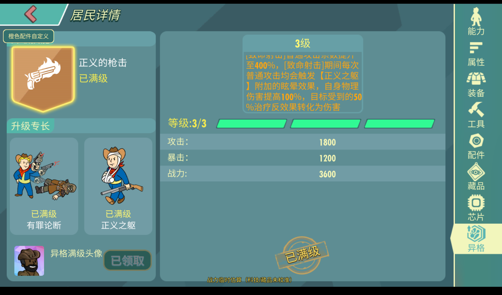

# 更新记录 / Changelog

## 5.24.50 — 缓存 52450.20261103.1

2026-11-03 · 预览版 · [版本介绍与截图 / Version details](docs/releases/5.24.50.md)

本次同步卢卡斯西蒙斯正式异格，三条分支各3级；下图为满异格状态。

- 同步果盘正式5.24.50资源、配置与原生库；71个变更产物完整校验。
- 接入卢卡斯西蒙斯三条异格分支，每条3级；现有居民自动迁移至满级异格。
- 实机171名居民保留；其余170名居民培养数据逐项一致。
- 4项专项回归通过；18秒教母实战正常胜利结算，观察到新增异格Buff。
- 继续保留第一层字节码封装、载荷校验与外部代码入口限制。

Lucas Simms' released upgrades are now included. Three branches migrate to tier 3, existing resident data is preserved, and an 18-second native battle completed successfully. Four focused regression tests passed.

## v0.1.0-rc.1 — 缓存 52441.20261029.1

- 对齐果盘5.24.41，47个配置包逐项校验。
- 加入P·A·M，按原表上限培养并放入宿舍；旧居民培养回退保留。
- 同步伊甸复生者技能异格3级官方配置修复。
- 保留百人战叠层限流、特效缓存回收和相机升降改进。
- 第一层发布封装：去调试字节码、载荷校验、关闭外置脚本与QA文件入口。
- 联盟BOSS服务器端新数值尚未验证；卢卡斯异格等待正式数据。
