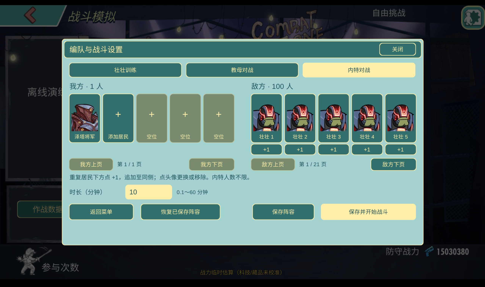

# Fallout Shelter Online — Study & Research Edition

[中文](README.md)

An unofficial offline Android research edition of Fallout Shelter Online for studying resident progression, team composition and combat mechanics. Provides installation packages, version history and update notes, with ongoing updates.

Current features include fully stocked resources, residents at maximum level and medal rank, local training-dummy battles, local 5v5 PvP simulation and local N-vs-N PvP simulation. More features are planned.

**Latest version 5.24.50:** Adds Lucas Simms' released skill upgrades, with three branches and three tiers each. [Version notes and maximum-upgrade screenshot](docs/releases/5.24.50.md#english) · [Full version history](CHANGELOG.md)

## Feature screenshots

Fully stocked resources

Maximum resident levels and medal ranks

Local training-dummy battles

Local 5v5 PvP simulation

Local N-vs-N PvP simulation

- Application version: `5.24.50`
- Guopan content version: `5.24.50`
- Local cache ID: `52450.20261103.1`
- Platform: Android ARM64, Android 7 or newer
- Release type: prerelease

This update adds Lucas Simms' released skill upgrades: three branches with three tiers each. Existing offline Lucas progression migrates to the maximum upgrade tiers. It retains P·A·M's maximum progression and five-star level-120 collection, plus the Eden Reborn correction. All 170 other resident progression records remain unchanged.

The repository provides release documentation, version manifests and installation files.

## Distribution and future updates

Binaries are provided in [GitHub Releases](https://github.com/vugpgbwefwq47397-debug/fallout-shelter-online-research/releases/tag/5.24.50). Download both `.part` files, `manifest.json` and `Join-Release.ps1` into one Windows folder, then run `./Join-Release.ps1` in PowerShell. The script verifies both parts and the resulting APK. Transfer that APK to Android and install it. GitHub's source-code archives contain documentation only and are not installers. Back up saves before upgrading; matching signing certificates are required for an in-place upgrade.

`updates/stable.json` and `updates/preview.json` reserve manifest locations for future releases. They do not currently enable network updates or remote script execution. Future updates should use complete signed application packages.

## Limits

Power values remain labelled estimates. Server-side boss-stat adjustments have not been independently recovered. Large battles can still suffer frame spikes.

One native configuration-load stall occurred and cleared after a cold emulator start. Startup stability remains unresolved; see the [acceptance record](docs/ACCEPTANCE.md).

Layer-one packaging strips Lua debug information, compiles local modules to bytecode, verifies the payload and disables development file entry points. APK signing detects unsigned package modifications. These measures do not guarantee source secrecy against a capable reverse engineer or prevent modified, re-signed copies.

No rights to third-party game assets, trademarks or code are granted by this repository documentation.
