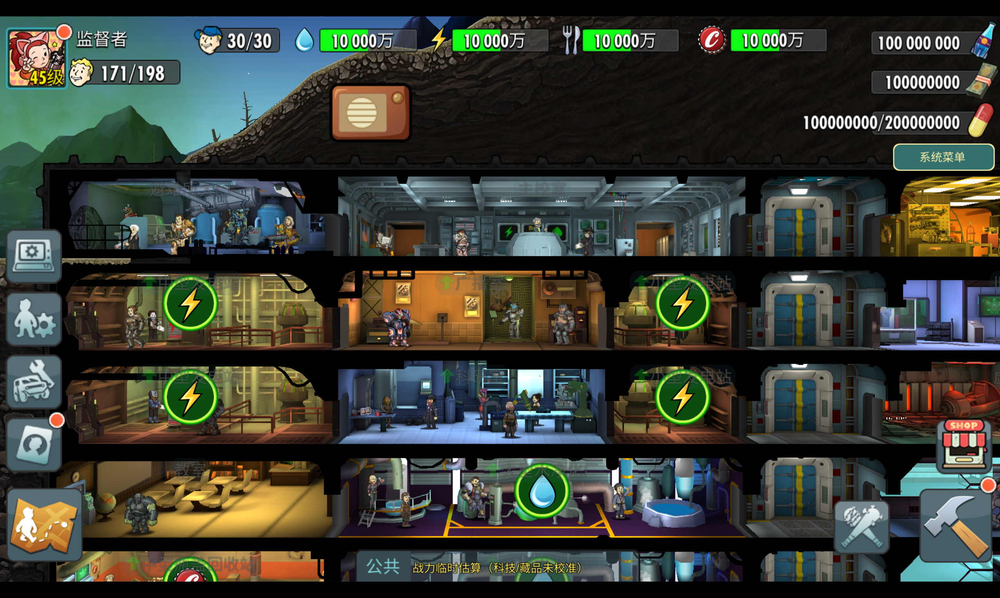
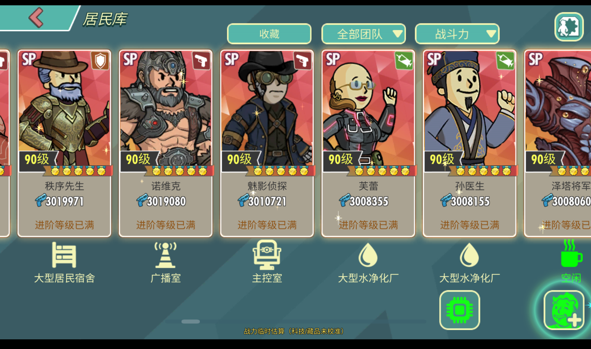
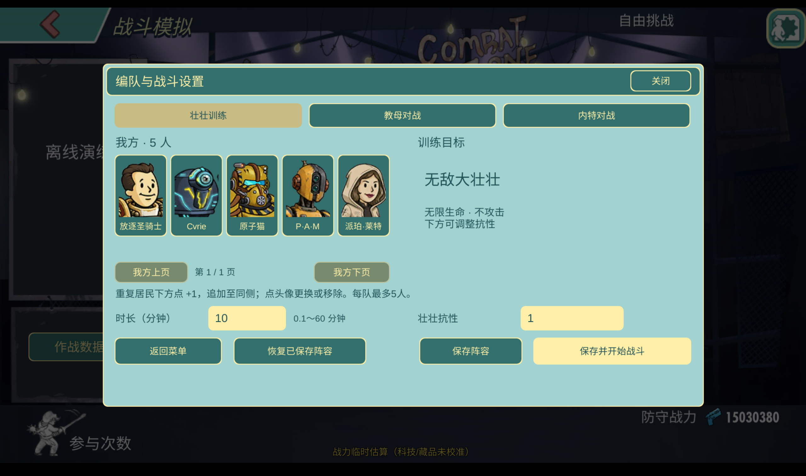
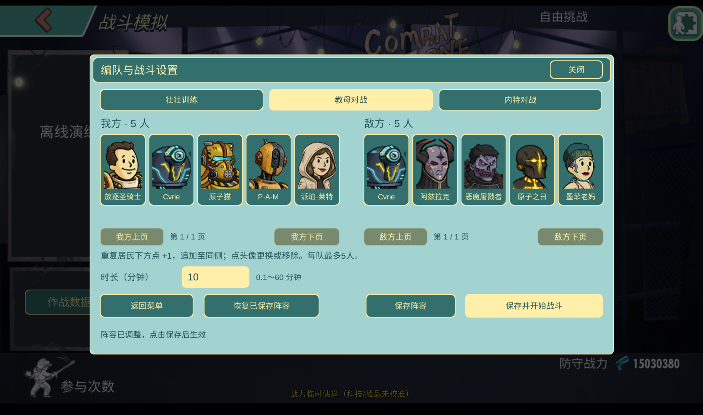
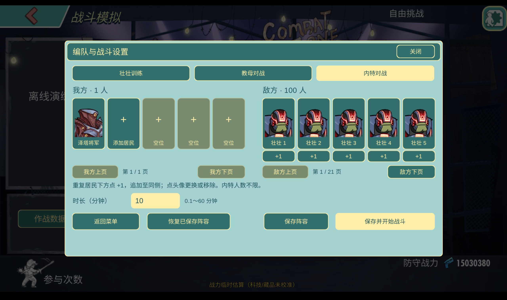

# 辐射避难所online学习研究版

[English](README.en.md) · [审核说明](REVIEW.md) · [验收记录](docs/ACCEPTANCE.md) · [更新记录](CHANGELOG.md)

辐射避难所Online非官方安卓离线学习研究版，用于研究居民培养、阵容搭配与战斗机制，提供安装包、版本记录及更新说明，持续更新。

目前已实现：全满资源、角色满勋满级、本地木桩对战、本地5V5 PVP模拟、本地NVN PVP模拟，后续会有功能更新。

**最新版本5.24.50：**同步卢卡斯西蒙斯正式异格，三条分支各3级。[查看本次版本介绍和满异格截图](docs/releases/5.24.50.md) · [全部版本日志](CHANGELOG.md)

## 功能展示

全满资源

角色满勋满级

本地木桩对战

本地5V5 PVP模拟

本地NVN PVP模拟

| 标识 | 当前预览版本 |
| --- | --- |
| 程序版本 | `5.24.50` |
| 果盘资源版本 | `5.24.50` |
| 本地缓存号 | `52450.20261103.1` |
| 支持平台 | Android ARM64，Android 7及以上 |
| 发布类型 | 预览版 / Prerelease |

更新内容：本次同步卢卡斯西蒙斯正式异格，三条分支各3级。

已通过4项专项测试，并完成原生战斗及结算验证。

仓库提供发布说明、版本清单和安装文件。

## 安装与更新

安装文件在[GitHub Releases](https://github.com/vugpgbwefwq47397-debug/fallout-shelter-online-research/releases/tag/5.24.50)提供。升级前请备份存档；同签名升级可以保留存档。版本号与本次同步的官方资源版本保持一致，本地缓存号用于区分同版本构建。

安装包超过 GitHub 单文件限制，发布时拆为两个分卷，通过随附合并脚本恢复 APK，并校验 SHA-256 后安装。分卷不直接安装。

在Windows上将两个`.part`文件、`manifest.json`和`Join-Release.ps1`放在同一文件夹，用PowerShell运行`./Join-Release.ps1`。脚本校验各分卷并生成APK；将生成的APK传到Android安装。GitHub页面的“Source code”压缩包只有本仓库说明，不能当安装包使用。

`updates/stable.json` 预留为稳定版更新清单路径；`updates/preview.json` 用于预览版。当前只预留清单，不会联网自动下载或执行外部脚本。将来更新通过完整签名安装包交付。

## 研究范围和限制

当前为预览版，仍有启动配置偶发卡住、百人战掉帧、战斗公式不准确及战力估算等已知限制。有bug欢迎反馈。

本轮曾发生一次原生配置加载卡住，冷启动模拟器后恢复；启动稳定性仍需修复与复测，详见验收记录。

第一层封装使用去除调试信息的 Lua 字节码、载荷完整性检查及 APK 签名，并关闭开发文件入口。这能减少直接读取源码和随手替换脚本，无法阻止有能力的逆向者提取运行数据、反编译字节码或重打包程序。

本仓库说明不授予第三方游戏素材、商标或代码的权利；相关权利属于原权利人。

本项目与官方运营无关联，仓库仅发布说明和封装产物。
