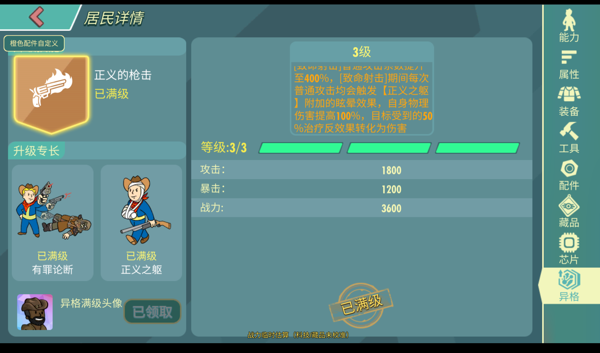

# 5.24.50｜卢卡斯西蒙斯异格更新

记录日期：2026-11-03 · 预览版 · 本地缓存号：52450.20261103.1

发布日期：2026-11-03 · [下载本版本 / Download this release](https://github.com/vugpgbwefwq47397-debug/fallout-shelter-online-research/releases/tag/5.24.50)

本次同步官方5.24.50版本资源，加入卢卡斯西蒙斯正式异格，三条分支各3级，并将现有离线卢卡斯的异格升满。

已通过4项专项测试，并完成原生战斗及结算验证。现有居民培养配置保留。

下图展示卢卡斯西蒙斯三条异格均已满级的状态。

安装方式及已知限制见[首页](../../README.md)；[返回版本日志](../../CHANGELOG.md)。

## English

### 5.24.50 | Lucas Simms Skill Upgrade Update

Recorded on November 3, 2026 · Preview · Local cache: 52450.20261103.1

Syncs official version 5.24.50 content and adds Lucas Simms' released skill upgrades: three branches with three tiers each. Existing offline Lucas upgrades are raised to the maximum tier, preserving other resident progression.

Four focused tests passed, including native combat and settlement validation. The screenshot above shows all three upgrade branches at maximum level.

[Installation and known issues](../../README.en.md) · [Version history](../../CHANGELOG.md)
